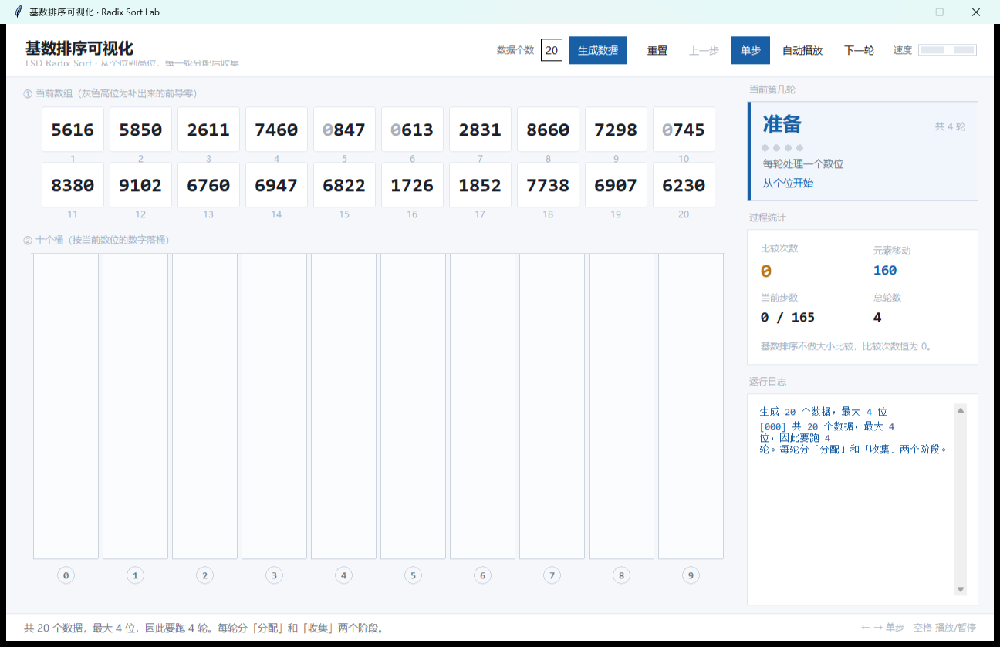
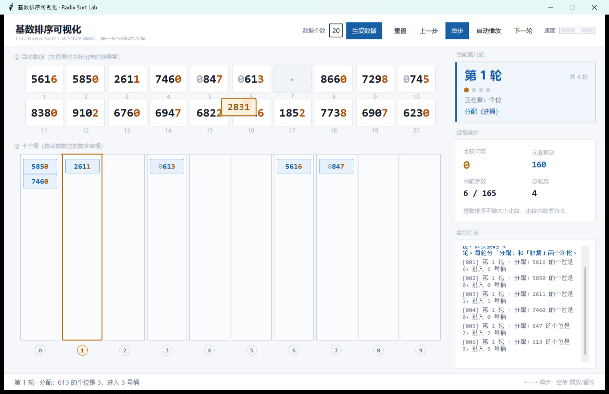
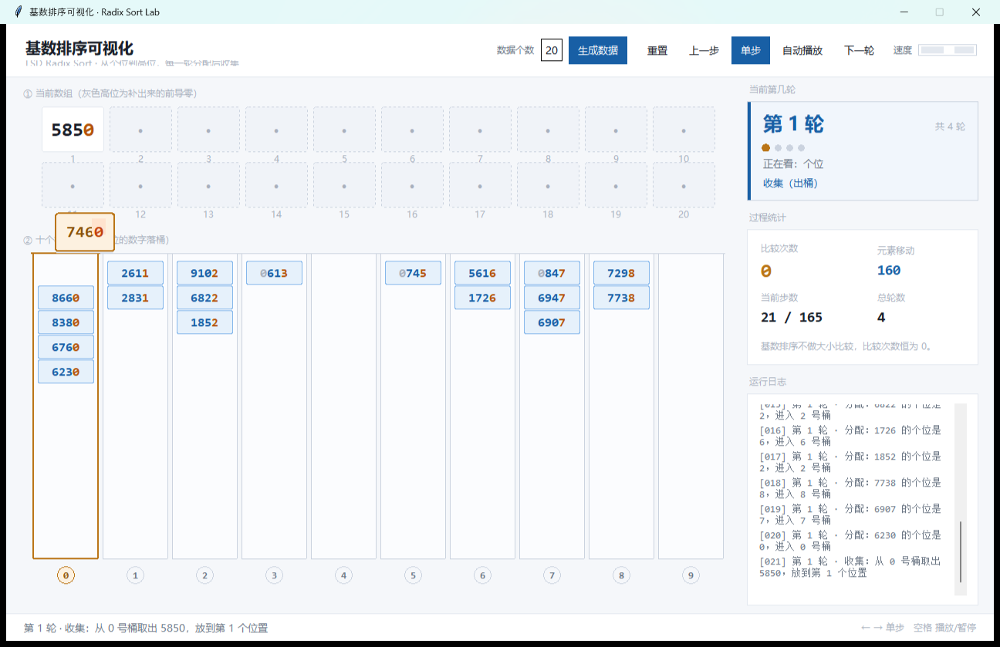
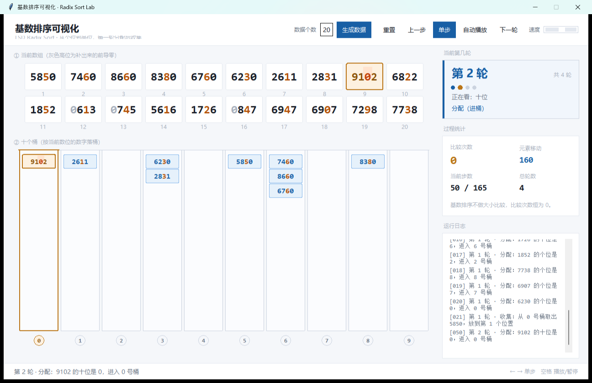
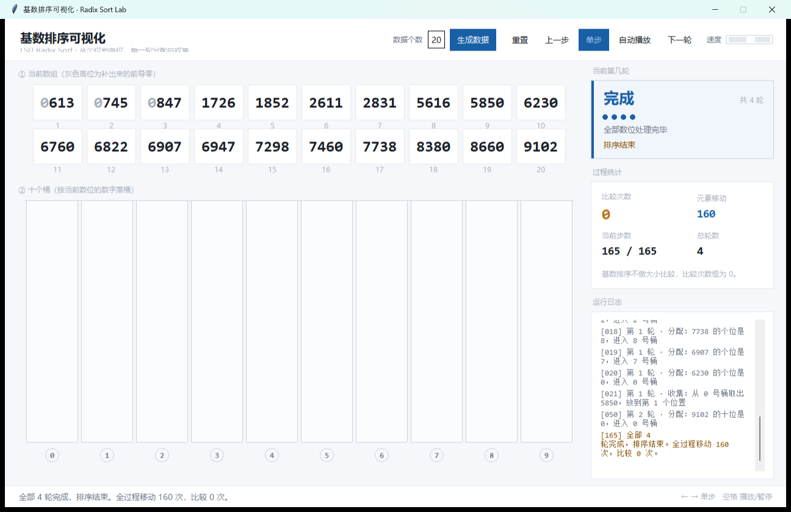

# 基数排序可视化 · Radix Sort Lab

> 《计算机与专业基础研讨》综合实验 —— 轻量级计算机基础概念可视化程序
>
> 用逐帧动画演示 **LSD 基数排序**（最低位优先）的完整过程：每一轮把数据按某个数位丢进 10 个桶，再依次收回，循环到最高位为止。



---

## 这个程序在演示什么

基数排序是一种**不比较大小**的排序算法。它不看两个数谁大谁小，而是按"个位、十位、百位、千位"逐位处理：

1. **分配**：看当前这一位是几，就把这个数丢进几号桶
2. **收集**：从 0 号桶到 9 号桶，依次把数倒回数组
3. **重复**：换个更高位，再做一遍，直到最高位处理完

跑完最后一轮，数组自然就有序了。全过程一次大小比较都没有发生。

程序把这两个阶段拆成一步一步的可视化动作，可以单步走、可以自动播、可以随时暂停回头看。

---

## 运行效果

### 分配阶段：按个位把数丢进桶

每个数的个位决定了它进哪个桶。当前正在处理的数会变成琥珀色，进的桶也会整列高亮。数被拿起来的时候，它在数组里的格子会变成虚线空框，然后一路飞到对应桶里。



### 收集阶段：从 0 号桶依次倒回数组

数组的格子会一个个被填满，还没填到的位置是虚线空框。桶里的数被取走后会消失，卡片沿着弧线飞回数组。



### 后面几轮：换更高的数位

第二轮看十位、第三轮看百位、第四轮看千位。每跑完一轮，这一位及更低位就变得有序了。右侧顶上的大字卡片会告诉你现在是第几轮。



### 排序完成

四轮跑完，数组从小到大排列。右侧统计显示：移动 160 次，**比较 0 次**。



---

## 功能特性

- **逐帧单步**：每一次"进桶"和"出桶"都是一个独立步骤，可以一步一步看清楚
- **飞行动画**：数字从数组飞进桶、再从桶飞回数组，飞行途中全程带高亮，一眼跟得上它去了哪
- **数位高亮**：当前这一轮处理的是哪一位，卡片上那一位就是橙色；正在移动的那张还会多一个橙色底块
- **轮次看板**：右侧顶上一张单独的大字卡片，写清"第几轮 / 共几轮"，配一排进度点
- **前导零可视化**：`51` 会显示成 `0051`，补出来的两个 `0` 用浅灰色画，提醒观众这不是数据本身
- **动态位数**：不固定轮数，而是按当前数据里的最大值自动决定要跑几轮
- **十桶实时状态**：每个桶里装了什么一目了然，当前操作的桶整列高亮
- **过程统计**：比较次数（恒为 0）、元素移动次数、当前步数、总轮数
- **运行日志**：每一步都带编号记录下来，可以对照着复盘
- **快捷键**：`←` `→` 单步，`空格` 播放/暂停
- **可控数据量**：默认 20 个，可在 10 到 20 之间调整，随时重新生成

---

## 快速开始

### 环境要求

- **Python 3.10 或以上**（用到了 `int | None` 这种类型标注语法）
- 只需要 Python 标准库里的 `tkinter`，**不需要安装任何第三方包**
- Windows / macOS / Linux 都可以运行

> **Windows 用户注意**：如果你安装的是 Microsoft Store 版本的 Python，
> 可能不带 tkinter。请在命令行执行 `python -c "import tkinter"` 验证，
> 如果报 `ModuleNotFoundError`，请到 python.org 重新安装并勾选 tcl/tk 组件。

### 运行

**方式一：双击 `run.bat`**（推荐，不会弹黑色控制台窗口）

**方式二：命令行**

```bash
# 1. 克隆仓库
git clone https://github.com/chengfayunsuan/radix-sort-lab.git
cd radix-sort-lab

# 2. 直接运行，不需要 pip install
python main.py
# 或者用 Windows 官方启动器
py main.py
```

如果双击 `main.py` 一闪而过，请在命令行里运行，就能看到具体的报错信息。

---

## 项目结构

```
radix-sort-lab/
├── README.md                            本文件：运行指南与团队分工
├── Project_Requirements_and_Design.md   需求与设计文档
├── AI_Prompts_Log.md                    AI 结对编程记录
├── LICENSE                              MIT 开源协议
├── .gitignore                           Git 忽略规则
├── main.py                              程序入口
├── run.bat                              Windows 一键启动
├── core/                                纯逻辑，不依赖任何界面代码
│   ├── __init__.py
│   ├── data_gen.py                      随机数据生成（含"不有序 + 每位分散"两道校验）
│   └── radix_engine.py                  排序核心：把整个过程展开成快照序列
├── ui/                                  界面层
│   ├── __init__.py
│   ├── theme.py                         配色、字体、圆角矩形、逐位数字绘制
│   ├── array_view.py                    数组图层（画上方卡片）
│   ├── bucket_view.py                   桶图层（画下方十个桶）
│   ├── stage_view.py                    舞台：把两个图层合到一张画布，并负责飞行动画
│   ├── side_panel.py                    右侧轮次看板、统计、日志
│   └── app.py                           主窗口，组装与事件响应
└── screenshots/                         运行截图（README 与设计文档引用）
```

### 为什么两个图层要画在同一张画布上

一开始数组和桶各占一张 Canvas，中间还夹着一个小标题。静止时没问题，但一旦要演示"数字飞进桶里"，跨 Canvas 是做不到的——图元不能越过自己的边界，Canvas 也没法真的透明。

所以两者合并成一张 924×660 的大画布（`stage_view.py`），数组层占上半部分，桶层占下半部分。两个图层自己不知道这个偏移，由舞台在构造时注入，所以它们仍然可以单独测试。

动画本身只是在这张画布上移动一个图元，代价很低，也不会有"飞到一半被裁掉"的情况。

### 为什么把 core 和 ui 分开

核心模块在初始化时**把整个排序过程一口气算完**，每一步生成一张完整的画面快照存进列表。界面层只负责"按下标取快照来画"。

这样做换来三个好处：

1. 单步、上一步、跳到下一轮，全部退化成"改一个数组下标"
2. 两个人可以同时改逻辑和界面，不会互相覆盖
3. 可以不启动界面单独测试——引擎跑对了，画面就一定是对的

---

## 核心算法

整个算法的核心只有这么几行：

```python
for 轮次 in range(总位数):
    桶 = [空] * 10
    for 每个数 in 数组:
        位数字 = (数 // 10 ** 轮次) % 10     # 取出这一位
        桶[位数字].append(数)                # 分配

    数组 = []
    for 每个桶 in 桶:
        数组.extend(桶)                      # 收集，保持桶内顺序

```

### 为什么必须从低位开始

因为每一轮都要**依赖上一轮的结果**。上一轮把低位排好了，这一轮按高位重排时，靠的是"同一位值相同的数保持原有相对顺序"——这个性质叫**稳定性**。

如果收集的时候不保持桶内顺序（比如在桶里再排一次序），稳定性就被破坏了，高位相同的数会被随意打乱，低位的成果全部作废，最终结果就是错的。

代码里对应这一行：

```python
value = remain[b].pop(0)      # 严格先进先出，这就是稳定性的实现
```

---

## 团队分工

| 姓名 | 学号 | 角色 | 负责内容 |
|---|---|---|---|
| 〔待填〕 | 〔待填〕 | 项目经理 | Git 分支规范、PR 审查与合并、README |
| 〔待填〕 | 〔待填〕 | 核心算法 | 排序引擎、快照序列设计 |
| 〔待填〕 | 〔待填〕 | 数据与统计 | 随机数据生成、两道校验、过程统计 |
| 〔待填〕 | 〔待填〕 | 界面开发 A | 数组卡片绘制、前导零渲染 |
| 〔待填〕 | 〔待填〕 | 界面开发 B | 桶视图、主窗口布局、事件响应 |
| 〔待填〕 | 〔待填〕 | 测试与展示 | 测试用例、PPT、演示视频、AI 提示词日志 |

## Git 协作规范

- `main` 分支只接受 Pull Request 合并，不直接提交
- 每人一个功能分支：`feature/engine`、`feature/data-gen`、`feature/array-view`、`feature/bucket-view`、`feature/app-layout`、`docs/report`
- 提交信息带前缀：`feat:` 新功能、`fix:` 修 bug、`docs:` 文档、`test:` 测试、`refactor:` 重构

---

## 开源协议

本项目采用 **MIT License**，欢迎用于教学与学习。

---

## 参考

1. 《计算机与专业基础研讨》课程讲义 · 经典排序算法
2. 《算法导论》第 8 章 · 线性时间排序（基数排序）
3. Python 官方文档 · `tkinter` — Python interface to Tcl/Tk
